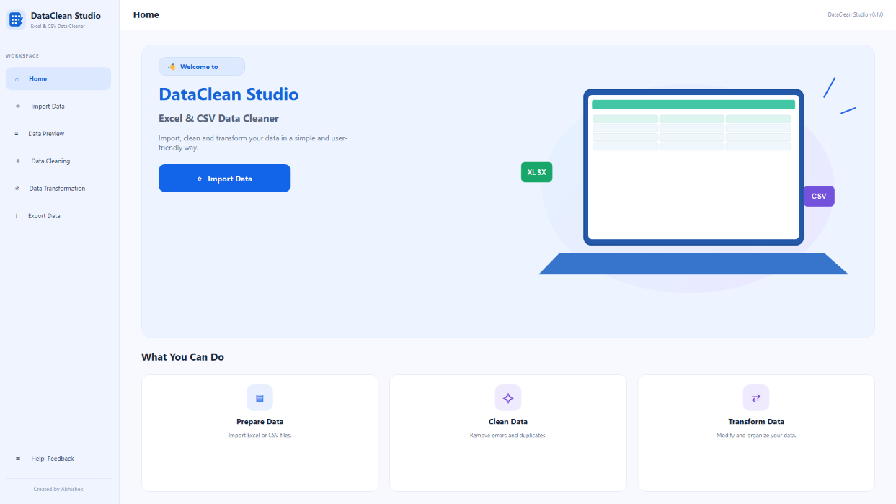
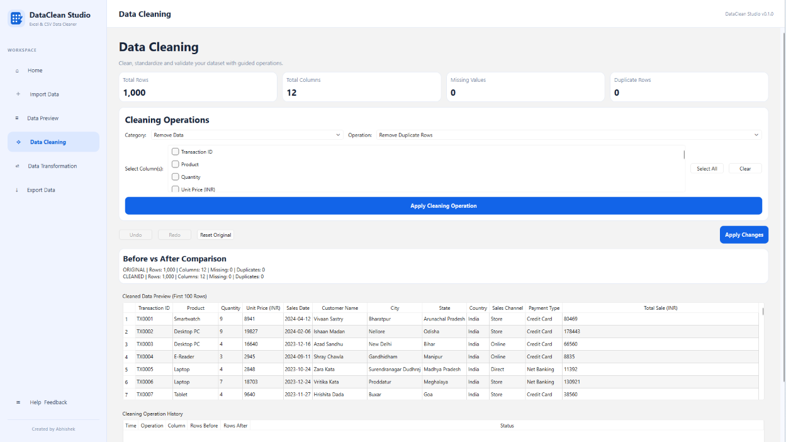
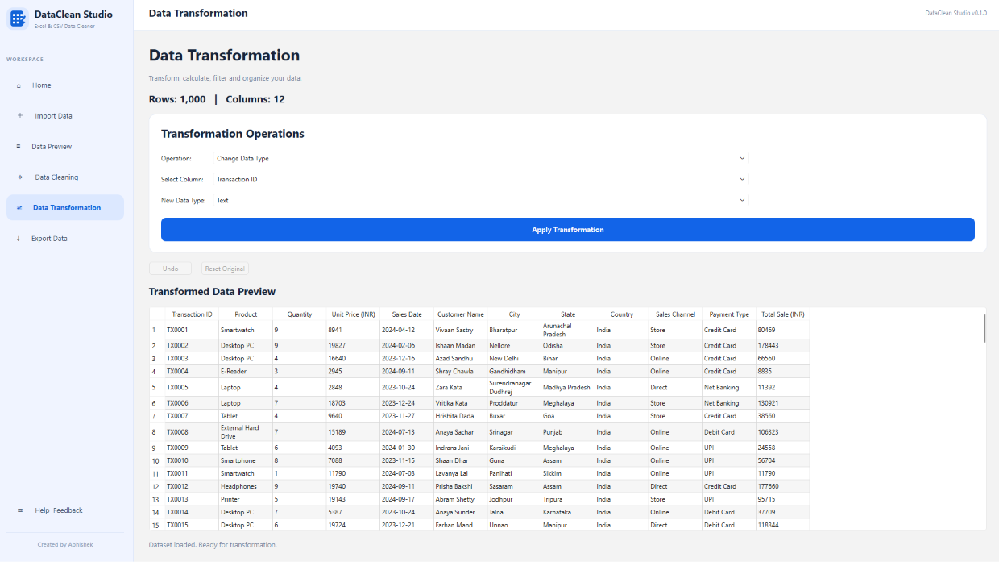

# DataClean Studio

### Excel & CSV Data Cleaning Desktop Application

DataClean Studio is a Python-based desktop application designed to make Excel and CSV data cleaning, transformation, and preparation easier through a simple and user-friendly graphical interface.

It helps users import datasets, preview records, clean unwanted data, perform calculations, transform columns, and prepare structured data for further analysis.

---

## Application Preview

### Home Screen



### Data Cleaning



### Data Transformation



---

## Key Features

### 1. Data Import
- Import Excel and CSV files.
- Load datasets into the application.
- Preview imported data.

### 2. Data Preview
- View dataset records in a table.
- Inspect columns and data values.
- Review data before cleaning or transformation.

### 3. Data Cleaning
- Remove duplicate rows.
- Remove blank rows and columns.
- Handle missing values.
- Clean and standardize text.
- Find and replace values.
- Perform date and number operations.
- Compare original and cleaned data.
- Undo and reset operations.

### 4. Data Transformation
- Change column data types.
- Create new calculated columns.
- Perform mathematical operations.
- Apply percentage-based calculations.
- Create conditional columns.
- Apply conditional percentage calculations.
- Split and merge columns.
- Sort and filter records.
- Calculate employee experience from joining dates.

### 5. HR Salary Bonus Calculation

Create new salary columns using percentage-based bonus calculations.

Example:

| Salary | Bonus | Updated Salary |
|---:|---:|---:|
| ₹60,000 | 10% | ₹66,000 |
| ₹50,000 | 5% | ₹52,500 |
| ₹40,000 | 8% | ₹43,200 |

Conditional calculations allow different bonus percentages based on salary thresholds.

### 6. Experience Calculation

Calculate employee experience using joining dates.

Available output formats:
- Years
- Years + Months
- Total Months
- Years + Months + Days

### 7. Data Export
Export transformed and cleaned datasets for further use.

---

## Technology Stack

| Technology | Purpose |
|---|---|
| Python | Core programming language |
| PySide6 | Desktop GUI |
| Pandas | Data processing |
| OpenPyXL | Excel file handling |
| Pytest | Testing |
| Git | Version control |
| GitHub | Source code hosting |

---

## Project Structure

```text
DataClean-Studio/
│
├── app/
├── config/
├── core/
│   ├── cleaning/
│   ├── data_preview/
│   ├── import_engine/
│   ├── project_manager/
│   ├── transformation/
│   └── type_detection/
│
├── database/
├── docs/
│   └── screenshots/
├── exports/
├── logs/
├── tests/
├── ui/
│   ├── pages/
│   ├── themes/
│   └── widgets/
│
├── main.py
├── requirements.txt
├── .gitignore
└── README.md
```

---

## Installation & Setup

### Prerequisites

- Python 3.12 or compatible version
- Git
- Visual Studio Code

### 1. Clone the Repository

```bash
git clone https://github.com/abhishekgupta-creator/DataClean-Studio.git
```

### 2. Open the Project Folder

```bash
cd DataClean-Studio
```

### 3. Create a Virtual Environment

```bash
python -m venv .venv
```

### 4. Activate the Virtual Environment

Windows PowerShell:

```powershell
.\.venv\Scripts\Activate.ps1
```

### 5. Install Dependencies

```bash
pip install -r requirements.txt
```

### 6. Run the Application

```bash
python main.py
```

---

## Testing

Run the available tests using:

```bash
pytest
```

---

## Future Improvements

- Interactive dashboard creation.
- More advanced data-cleaning operations.
- Additional HR and business analytics tools.
- Improved data visualization.
- Windows executable distribution.
- AI-powered data transformation suggestions.

---

## Developer

**Created by Abhishek Gupta**

GitHub: [abhishekgupta-creator](https://github.com/abhishekgupta-creator)

Project Repository: [DataClean Studio](https://github.com/abhishekgupta-creator/DataClean-Studio)

---

*DataClean Studio — Simple, Smart & Organized Data Preparation.*